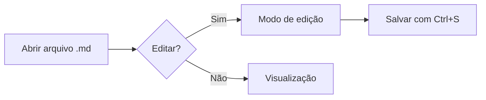
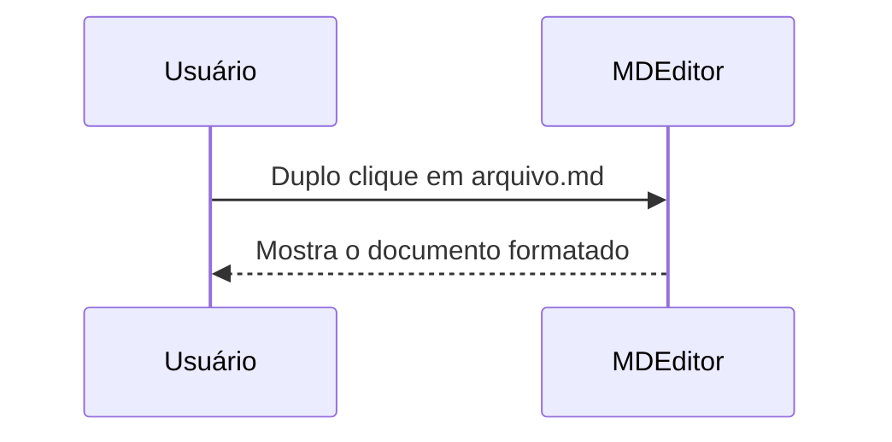

# Guia de Markdown do MDEditor

Bem-vindo ao **MDEditor**! Este guia mostra toda a sintaxe Markdown que o aplicativo entende. Clique em qualquer bloco para editá-lo direto na página (modo **Editar na página**). Para ver o Markdown completo ao lado do resultado, use o ícone `</>` no topo.

> [!TIP]
> Ao editar na página, digite `/` num bloco vazio para escolher o tipo de bloco, ou use as alças **+** e **⋮⋮** à esquerda de cada bloco.

## Sumário

- [Títulos](#títulos)
- [Ênfase e estilos de texto](#ênfase-e-estilos-de-texto)
- [Listas](#listas)
- [Links e imagens](#links-e-imagens)
- [Citações e alertas](#citações-e-alertas)
- [Código](#código)
- [Tabelas](#tabelas)
- [Fórmulas matemáticas](#fórmulas-matemáticas)
- [Diagramas](#diagramas)
- [Outros recursos](#outros-recursos)
- [Atalhos úteis](#atalhos-úteis)

---

## Títulos

Use de um a seis `#` no início da linha:

# Título 1
## Título 2
### Título 3
#### Título 4
##### Título 5
###### Título 6

Também é possível sublinhar com `===` (título 1) ou `---` (título 2):

Título alternativo
------------------

## Ênfase e estilos de texto

| Resultado | Markdown |
| --- | --- |
| **negrito** | `**negrito**` ou `__negrito__` |
| *itálico* | `*itálico*` ou `_itálico_` |
| ***negrito e itálico*** | `***texto***` |
| ~~tachado~~ | `~~tachado~~` |
| ==realçado== | `==realçado==` |
| ++sublinhado++ | `++sublinhado++` |
| H~2~O | `H~2~O` (subscrito) |
| x^2^ | `x^2^` (sobrescrito) |
| `código` | `` `código` `` |
| <kbd>Ctrl</kbd> + <kbd>S</kbd> | `<kbd>Ctrl</kbd>` |

Parágrafos são separados por uma linha em branco.
Para quebrar a linha sem criar um novo parágrafo, termine a linha com uma barra invertida\
ou com dois espaços.

Caracteres especiais podem ser escapados com `\`: \*isto não fica em itálico\*.

## Listas

### Lista com marcadores

- Item um
- Item dois
  - Subitem (recue com `Tab`)
  - Outro subitem
    - Terceiro nível
- Item três

### Lista numerada

1. Primeiro passo
2. Segundo passo
   1. Detalhe A
   2. Detalhe B
3. Terceiro passo

### Lista de tarefas

- [x] Instalar o MDEditor
- [x] Abrir um arquivo `.md`
- [ ] Clicar nas caixas de seleção — elas atualizam o arquivo!
- [ ] Salvar com `Ctrl+S`

### Lista de definição

Markdown
: Linguagem de marcação leve criada por John Gruber em 2004.

MDEditor
: Editor e visualizador de Markdown para Windows.

## Links e imagens

- Link simples: [site do CommonMark](https://commonmark.org)
- Link com título: [passe o mouse aqui](https://commonmark.org "Especificação CommonMark")
- Endereço automático: https://www.markdownguide.org
- Link para uma seção deste documento: [ir para Tabelas](#tabelas)
- Link para outro arquivo: `[Leia-me](LEIAME.md)` abre o arquivo no MDEditor
- E-mail: <contato@exemplo.com>

Links de referência deixam o texto mais limpo: veja o [guia oficial][guia].

[guia]: https://daringfireball.net/projects/markdown/syntax "Sintaxe original"

Imagens usam a mesma sintaxe com `!` na frente: ``. Caminhos relativos são resolvidos a partir da pasta do documento.


> [!NOTE]
> Dica: no editor, cole uma imagem com `Ctrl+V` — ela é salva automaticamente na pasta `imagens` ao lado do documento.

## Citações e alertas

> "A simplicidade é o último grau de sofisticação."
>
> — Leonardo da Vinci
>
> > Citações podem ser aninhadas.

Alertas (no estilo do GitHub):

> [!NOTE]
> Informação útil que o leitor deve notar.

> [!TIP]
> Uma dica para fazer as coisas melhor ou mais facilmente.

> [!IMPORTANT]
> Informação essencial para o leitor.

> [!WARNING]
> Conteúdo urgente que exige atenção imediata.

> [!CAUTION]
> Aviso sobre riscos ou consequências negativas.

## Código

Código na linha: use `console.log()` entre crases.

Blocos de código com realce de sintaxe:

```javascript
// Calcula o fatorial de um número
function fatorial(n) {
  return n <= 1 ? 1 : n * fatorial(n - 1);
}
console.log(`5! = ${fatorial(5)}`);
```

```python
def saudacao(nome: str) -> str:
    """Retorna uma saudação."""
    return f"Olá, {nome}!"

print(saudacao("mundo"))
```

```powershell
Get-ChildItem -Path . -Filter *.md | ForEach-Object { $_.Name }
```

```diff
- linha removida
+ linha adicionada
```

Blocos com quatro espaços de recuo também viram código:

    texto pré-formatado
    sem realce de sintaxe

## Tabelas

| Recurso            | Suporte | Observação                     |
| :----------------- | :-----: | -----------------------------: |
| Alinhamento        |   ✅    |       esquerda, centro, direita |
| Formatação inline  |   ✅    |     **negrito**, `código`, etc. |
| Formatar colunas   |   ✅    |           `Ctrl+Alt+F` no editor |

Use `:---` (esquerda), `:---:` (centro) e `---:` (direita) na linha separadora.

## Fórmulas matemáticas

Fórmula na linha: a famosa equação $E = mc^2$ ou $\sqrt{a^2 + b^2}$.

Bloco de fórmula:

$$
\int_{-\infty}^{\infty} e^{-x^2}\,dx = \sqrt{\pi}
$$

$$
f(x) = \sum_{n=0}^{\infty} \frac{f^{(n)}(a)}{n!}(x-a)^n
$$

## Diagramas

Diagramas são desenhados com [Mermaid](https://mermaid.js.org):





## Outros recursos

### Notas de rodapé

O Markdown foi criado em 2004[^1] e é usado em todo lugar[^nota].

[^1]: Por John Gruber, com a colaboração de Aaron Swartz.
[^nota]: GitHub, documentação, fóruns, anotações pessoais…

### Emojis

Escreva o nome entre dois-pontos: :rocket: :tada: :white_check_mark: :bulb: :heart:

### Abreviações

O HTML e o CSS são a base da web.

*[HTML]: HyperText Markup Language
*[CSS]: Cascading Style Sheets

### Seção recolhível

<details>
<summary>Clique para expandir</summary>

Conteúdo oculto que aparece ao clicar. Pode conter **Markdown**, listas e código.

</details>

### Linha horizontal

Três ou mais `-`, `*` ou `_` em uma linha:

***

### HTML embutido

Você pode usar <u>tags HTML</u> simples, como <sup>sobrescrito</sup> e <sub>subscrito</sub>.

<!-- Comentários HTML não aparecem na visualização. -->

## Atalhos úteis

| Ação | Atalho |
| --- | --- |
| Alternar visualizar / editar | <kbd>Ctrl</kbd>+<kbd>E</kbd> |
| Modo dividido | <kbd>Ctrl</kbd>+<kbd>\\</kbd> |
| Salvar | <kbd>Ctrl</kbd>+<kbd>S</kbd> |
| Negrito / Itálico | <kbd>Ctrl</kbd>+<kbd>B</kbd> / <kbd>Ctrl</kbd>+<kbd>I</kbd> |
| Título 1 a 6 | <kbd>Ctrl</kbd>+<kbd>1</kbd> … <kbd>Ctrl</kbd>+<kbd>6</kbd> |
| Link | <kbd>Ctrl</kbd>+<kbd>K</kbd> |
| Localizar | <kbd>Ctrl</kbd>+<kbd>F</kbd> |
| Todos os atalhos | <kbd>Ctrl</kbd>+<kbd>/</kbd> |
